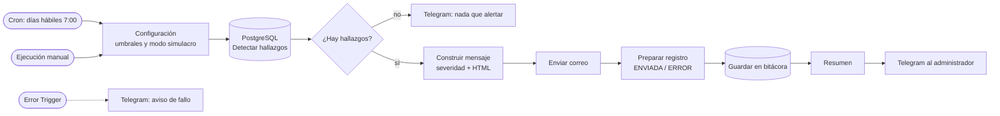
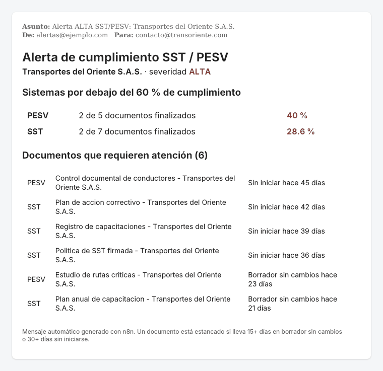

# Alertas de cumplimiento SST / PESV con n8n


Automatización en **n8n** que revisa cada día la base de datos de seguridad y salud en el trabajo (SG-SST) y de seguridad vial (PESV), detecta qué organizaciones tienen documentos atrasados o un cumplimiento bajo, y les envía una alerta por correo. Cada envío queda registrado y no se repite.

Se conecta a la base [`proyecto_base_de_datos_en_PostgreSQL`](https://github.com/sebastianace/proyecto_base_de_datos_en_PostgreSQL) (19 tablas, multiempresa) **sin modificarla**.

<!-- Cuando tengas la captura del workflow, guárdala como docs/img/workflow.png y quita las marcas de comentario de la línea siguiente:

-->

## El problema

En el SG-SST y el PESV, cada empresa debe diligenciar documentos (políticas, matrices de peligros, planes de capacitación, hojas de vida de conductores y vehículos). En la práctica los documentos se quedan en borrador durante semanas o nunca se empiezan, y nadie lo nota hasta una auditoría.

## Qué hace

Cada día hábil a las 7:00 (hora de Colombia):

1. Consulta la base de datos y calcula, por organización activa:
   - **Documentos estancados**: en `BORRADOR` sin cambios hace 15 días o más, o en `NO_INICIADO` desde hace 30 días o más.
   - **Sistemas en riesgo**: SST o PESV con menos del 60 % de documentos finalizados.
2. Asigna una **severidad** (ALTA, MEDIA o BAJA) y arma un correo en HTML con el detalle.
3. Envía **un correo por organización** a su contacto.
4. Guarda el resultado de cada envío (`ENVIADA` o `ERROR`) en una bitácora.
5. Manda un **resumen al administrador por Telegram**. Si ese día no hay nada que alertar, también le avisa, para que sepa que el workflow corrió.

Los umbrales se cambian en un solo nodo (`Configuración`), sin tocar código.

## Arquitectura



| Nodo | Tipo | Función |
|---|---|---|
| Cada día hábil a las 7:00 / Ejecución manual | Schedule Trigger / Manual Trigger | Dos formas de iniciar el flujo |
| Configuración | Set | Umbrales, correo de prueba y modo simulacro |
| Detectar hallazgos | Postgres | Consulta con parámetros (`$1`..`$4`); reintenta 3 veces |
| ¿Hay hallazgos? / Aviso: nada que alertar | If + Telegram | Si no hay nada que alertar, avisa al administrador |
| Construir mensaje | Code (JavaScript) | Calcula la severidad y genera el correo HTML |
| Enviar correo | Send Email | Un correo por organización; si falla, el flujo continúa |
| Preparar registro | Code (JavaScript) | Marca cada envío como `ENVIADA` o `ERROR` |
| Guardar en bitácora | Postgres | Inserta en `alertas.bitacora`; reintenta 3 veces |
| Resumen / Aviso por Telegram | Code + Telegram | Resumen de la ejecución para el administrador |
| Workflow 02 | Error Trigger + Telegram | Avisa si el workflow principal falla |

## Ejemplo de alerta

Así se ve el correo que recibe una organización (generado con el código del workflow y los datos de demostración):



## Reglas de severidad

| Severidad | Condición |
|---|---|
| **ALTA** | Algún sistema con menos de 30 % de cumplimiento, o 5 o más documentos estancados |
| **MEDIA** | Algún sistema bajo el umbral configurado (60 %), o 3 a 4 documentos estancados |
| **BAJA** | El resto de los casos con hallazgos |

## Decisiones de diseño

- **Esquema propio (`alertas`)**: el proyecto crea su bitácora en un esquema aparte. Las tablas de la base SST/PESV no se tocan.
- **Mínimo privilegio**: n8n se conecta con el rol `n8n_alertas`, que solo lee 5 tablas y escribe en su bitácora. No puede modificar ni borrar datos del sistema (hay una prueba automática que lo verifica).
- **Modo simulacro activado por defecto**: al importar el workflow, todos los correos se redirigen a una dirección de prueba. Hay que desactivarlo a propósito para enviar de verdad.
- **No repetir alertas**: una organización que ya recibió una alerta real en los últimos 7 días se omite. Los simulacros y los envíos con error no cuentan, así que se pueden probar y reintentar.
- **Cumplimiento calculado en vivo**: la consulta usa la tabla `documents` y no las vistas materializadas, porque estas pueden estar desactualizadas hasta que alguien las refresque.
- **Un fallo no detiene todo**: si un correo falla, las demás organizaciones siguen y el fallo queda en la bitácora.

El detalle y las alternativas descartadas están en [`docs/decisiones.md`](docs/decisiones.md).

## Estructura del repositorio

```
├── workflows/
│   ├── 01_alertas_cumplimiento_sst_pesv.json   # workflow principal (sin credenciales)
│   └── 02_manejo_de_errores.json               # aviso de errores
├── sql/
│   ├── 01_esquema_alertas.sql                  # bitácora + rol de mínimo privilegio
│   ├── 02_consulta_hallazgos.sql               # la consulta del nodo Postgres
│   └── 03_datos_demo.sql                       # envejece documentos para la demo
├── tests/
│   ├── probar_consulta.sh                      # consulta, deduplicación y permisos
│   ├── probar_codigo_nodos.js                  # severidad, escape de HTML, simulacro y errores
│   └── validar_workflows.py                    # JSON válido, sin secretos, simulacro activo
├── docs/
│   ├── decisiones.md
│   ├── ejemplo_correo.html                     # un correo de alerta, generado con los datos de demostración
│   └── img/ejemplo_correo.png                  # captura de ese correo
├── .github/workflows/ci.yml                    # pruebas automáticas en cada push
├── docker-compose.yml                          # PostgreSQL 16 + n8n
└── .env.example
```

## Cómo ejecutarlo

Necesitas [Docker](https://www.docker.com/) y Git.

**1. Clona los dos repositorios, uno junto al otro**

```bash
git clone https://github.com/sebastianace/proyecto_base_de_datos_en_PostgreSQL.git
git clone https://github.com/sebastianace/Proyecto_AlertasSST_n8n_AcelasVladimir.git
cd Proyecto_AlertasSST_n8n_AcelasVladimir
```

**2. Configura las claves y levanta los servicios**

```bash
cp .env.example .env      # edita las tres claves
docker compose up -d
```

**3. Instala la base de datos y el esquema de alertas**

```bash
docker cp ../proyecto_base_de_datos_en_PostgreSQL/proyecto/sql/00_instalacion_completa.sql alertas_postgres:/tmp/
docker compose exec postgres psql -U postgres -d sst_pesv -v ON_ERROR_STOP=1 -q -f /tmp/00_instalacion_completa.sql
docker compose exec postgres psql -U postgres -d sst_pesv -v ON_ERROR_STOP=1 -q -v clave=LA_CLAVE_DE_N8N_ALERTAS -f /sql/01_esquema_alertas.sql
docker compose exec postgres psql -U postgres -d sst_pesv -v ON_ERROR_STOP=1 -q -f /sql/03_datos_demo.sql
```

Usa en `LA_CLAVE_DE_N8N_ALERTAS` el valor de `N8N_ALERTAS_CLAVE` de tu `.env`. El tercer comando es solo para la demostración.

**4. Configura n8n** en <http://localhost:5678>

1. Crea tu cuenta de administrador.
2. Importa los dos archivos de `workflows/` (*Workflows → Import from file*).
3. Crea las credenciales y asígnalas a los nodos:
   - **Postgres**: host `postgres`, puerto `5432`, base `sst_pesv`, usuario `n8n_alertas` y su clave.
   - **SMTP**: el de tu proveedor de correo (con Gmail, una [contraseña de aplicación](https://support.google.com/accounts/answer/185833)).
   - **Telegram**: el token de tu bot (créalo con @BotFather).
4. En el nodo `Configuración` pon tu `correo_prueba`, tu `correo_remitente` y tu `telegram_chat_id`. En el workflow 02, pon también el chat id en el nodo de Telegram.
5. En el workflow 01, abre *Settings → Error workflow* y elige el workflow 02.

**5. Pruébalo**

Pulsa **Execute workflow** en el workflow 01. Con los datos de demostración debes recibir 4 alertas simuladas en tu correo de prueba:

| Organización | Severidad | Documentos estancados |
|---|---|---|
| Transportes del Oriente S.A.S. | ALTA | 6 |
| Constructora Andina Ltda. | MEDIA | 3 |
| Logistica Bogota Express | ALTA | 4 |
| Alimentos del Valle S.A. | BAJA | 1 |

Revisa la bitácora:

```sql
SELECT tenant_id, severidad, destinatario, es_simulacro, estado, creada_en
FROM alertas.bitacora ORDER BY id;
```

Cuando quieras enviar a las organizaciones reales, cambia `modo_simulacro` a `false`.

## Pruebas

```bash
bash tests/probar_consulta.sh      # consulta, deduplicación y permisos del rol (5 comprobaciones)
node tests/probar_codigo_nodos.js  # código de los nodos Code: severidad, HTML, simulacro, errores (15 pruebas)
python3 tests/validar_workflows.py # workflows válidos, sin secretos y con el simulacro activo
```

Se ejecutan solas en cada push con GitHub Actions: la acción instala la base de datos real, carga los datos de demostración y corre las pruebas. Además, el workflow completo se ejecutó dentro de un n8n real con la base real y un servidor de correo de prueba (envío correcto, envío con error, no repetir alertas y el aviso de "nada que alertar"). Los detalles y lo que esa prueba no cubre están en [`docs/decisiones.md`](docs/decisiones.md).

## Limitaciones y próximos pasos

- El correo se envía al contacto principal de cada organización. Una mejora sería notificar también al responsable de SST (tabla `persons`, cargo "Coordinador HSEQ").
- Las alertas no tienen un historial visual. Se podría agregar un panel con la bitácora.
- Los umbrales son iguales para todas las organizaciones.

## Qué demuestra este proyecto

- **Automatización con n8n** de punta a punta: disparadores, ramas, código JavaScript, reintentos y manejo de errores.
- **PostgreSQL**: consultas con CTE y agregación condicional, parámetros, esquema propio y roles de mínimo privilegio.
- **Ingeniería**: pruebas automáticas, CI, Docker, y decisiones documentadas (qué se eligió y qué se descartó).

## Proyecto relacionado

[**Agente de IA para SST/PESV**](https://github.com/sebastianace/Proyecto_AgenteIA_SSTPESV_n8n_AcelasVladimir): un asistente en Telegram que responde preguntas sobre esta misma base de datos, sin escribir SQL libre.

## Autor

**Sebastián Acelas** · [Portafolio](https://sebastianace.github.io/Portafolio-Campus/) · [LinkedIn](https://www.linkedin.com/in/vladimir-sebastian-acelas-rodriguez-623342427/) · [GitHub](https://github.com/sebastianace)

Licencia [MIT](LICENSE).
